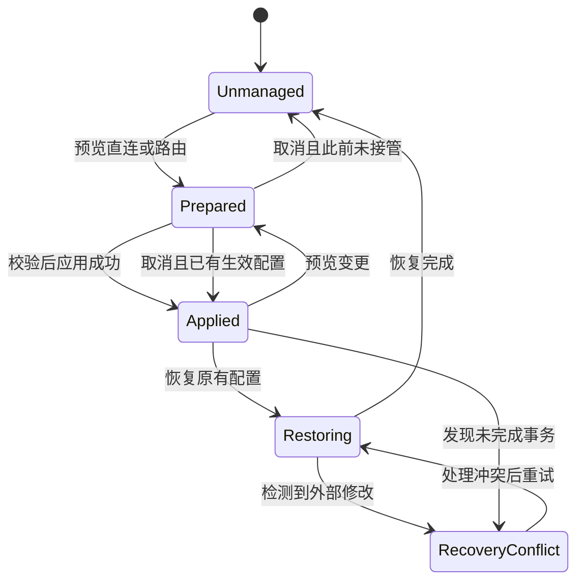
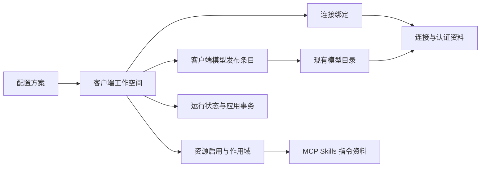

# SwitchX 多客户端与 Claude Code 接入方案

状态：已开始实施。首批客户端基础与导航已落地，后续功能按里程碑推进。

核对日期：2026 年 10 月 16 日。方案源码基线为 SwitchX `eb1bac0`、本地参考仓库 `others/cc-switch` 的 `09bce301`；本机 Claude Code 为 `2.1.301`。除下方进度记录明确列出的部分外，后续模块和表结构仍为拟议设计，实际数据库版本与客户端能力应在实施时重新确认。

SwitchX 将从围绕单个 Codex 工作空间组织功能，扩展为同时管理 Codex 与 Claude Code。客户端拥有各自的配置、模型发布和运行状态；连接、账号、扩展资料和用量分析按明确的绑定关系复用。界面采用客户端侧栏，Claude Code 的模型页以完整的自定义模型列表为主体。

首个可用版本完成多客户端基础、Claude 直连、自定义模型列表、配置预览与恢复。后续依次交付原生 Messages 路由与聚合、协议转换、扩展管理和日常工作流。完整对齐以功能矩阵逐项验收，不以首个版本代替完整交付。

阅读入口：[功能范围](#3-功能对齐矩阵)、[界面设计](#4-信息架构与页面设计)、[动效规范](#5-视觉与动效规范)、[数据与迁移](#8-数据结构与迁移)、[配置保护](#10-配置所有权与凭据)、[实施阶段](#15-实施里程碑)、[验收清单](#16-验收设计)。

实施进度 2026 年 10 月 16 日：

- 新增 `ClientKind`、规范化工作空间身份和 Claude 模型菜单能力版本判断。
- 数据库升级到 18，保存客户端目录、所选工作空间和页面记录；升级前生成私有 SQLite 备份，覆盖 WAL 和并发打开场景。
- 新增原生客户端导航、Claude 目录检查页面和切换动效；视图切换不写客户端配置，保留现有 Codex 路由并清理过期预览与凭据编辑内容。
- Codex 的路由、预览和账号同步目录归入 `CodexRuntime`。多工作空间并行路由及完整适配器仍需后续实现。
- `make check` 通过：364 个 Rust 测试通过，2 个既有 CLI 探针按默认配置忽略；41 项脚本测试中 2 项因缺少平台工具跳过。

本批未实现 Claude 连接保存、直连写入、自定义模型列表编辑或发布，也未创建计划中的连接与模型绑定表。下一批继续完善工作空间适配，并交付 M1 的 Claude 直连与模型菜单。

界面记录：[Claude 浅色最小窗口](previews/client-workspaces/claude-1000-light.png)、[Claude 深色大窗口](previews/client-workspaces/claude-1400-dark.png)、[Codex 连接页](previews/client-workspaces/codex-1000-light.png)。图片由实际 Slint 界面使用合成资料渲染。

## 1 目标与范围

### 1.1 用户要完成的任务

1. 在同一个窗口管理 Claude Code 和 Codex，随时看清各自正在使用什么配置。
2. 为 Claude Code 添加官方 API、兼容网关、自定义服务或本机官方登录配置。
3. 把自行选择的模型发布到 Claude Code 的 `/model` 菜单，控制名称、顺序和默认模型。
4. 在需要时通过 SwitchX 将不同供应商的模型放进同一个客户端菜单。
5. 管理每个客户端启用的 MCP、Skills、指令和配置方案。
6. 查看实际请求、用量、额度和会话，并能恢复接入前的配置。
7. 升级后继续使用原有 Codex 连接、模型、账号、备用上游和历史记录。

### 1.2 对齐边界

功能参考本地 CC Switch 的 Claude Code 管理能力，包括直连、路由、聚合、模型列表、账号接入、MCP、Skills、指令、配置方案、会话、用量、额度和托盘操作。[CC Switch 功能说明](../others/cc-switch/README_ZH.md)

CLI 安装升级、同步、Deep Link、编辑器联动和 WSL 支持属于完整产品对齐范围，单独列入后续里程碑。其他客户端的用量读取继续保留；本轮可写客户端适配器先覆盖 Codex 和 Claude Code。Claude Desktop 若以后需要独立管理，另设客户端标识和适配器，不把它等同于 Claude Code。

保留 SwitchX 已有的安全和恢复约定：显式模型路由、凭据隔离、写入前预览、外部修改冲突检测、只恢复受管字段。参考实现的具体限制和写入行为不直接替代这些约定。

### 1.3 核心设计决定

| 问题 | 方案 |
| --- | --- |
| 客户端入口 | 左侧一级导航展示客户端，默认显示 Codex 与 Claude Code |
| 切换视图 | 只改变管理上下文，不切换连接、不停止路由、不写客户端文件 |
| 模型主界面 | 完整模型列表；默认模型、角色映射和高级能力分开设置 |
| 配置切换 | 保存草稿、查看差异、应用、核对结果，分别保留状态 |
| 并行运行 | 每个客户端配置目录拥有独立运行状态、监听端口和本地令牌 |
| 连接共享 | 通过绑定复用；端点、协议或认证不同则使用不同连接记录 |
| 现有 Codex 行为 | 先封装现有实现，再扩展客户端，迁移不自动改写用户配置 |
| 旧版本客户端 | 可以使用其支持的功能；缺失能力显示原因，不静默生成无效配置 |
| 原型用途 | 确认布局和操作层级；正式行为以本方案和验收结果为准 |

## 2 现状与能力基线

### 2.1 SwitchX 可复用的部分

| 现有能力 | 入口 | 复用方式 |
| --- | --- | --- |
| API、ChatGPT、Grok 连接和账号 | `src/app/`、`src/chatgpt/`、`src/xai/` | 保留现有保存、绑定与刷新流程；增加客户端兼容性判断 |
| 模型目录与显式映射 | `src/catalog.rs`、`src/app/models.rs` | 保留模型身份、显示名称和历史别名；将客户端配置生成拆开 |
| Codex 配置预览和恢复 | `src/codex/` | 包装为 Codex 适配器，复用恢复规则和验证方法 |
| 本地请求转发 | `src/router.rs` | 复用监听、认证、取消、预算和记录基础，新增 Messages 入口 |
| 路由生命周期 | `src/route_session.rs` | 从一个实例扩展为按工作空间索引的实例 |
| Claude 本地用量导入 | `src/usage/claude_logs.rs` | 保留增量读取、回复快照补全和缓存计数，补路由关联 |
| 用量分析和多客户端筛选 | `src/app/usage.rs`、`ui/pages/usage.slint` | 保留现有界面能力，增加从客户端页面进入时的筛选上下文 |
| SwitchX MCP 服务 | `src/mcp.rs`、`src/mcp/setup.rs` | 扩展目标客户端，保留只读、写入、控制权限分层 |
| 界面主题与动画 | `ui/tokens.slint`、`ui/components.slint` | 延续暖灰、苔绿和现有动画偏好，新增客户端导航组件 |

当前路由公开 `/v1/models`、`/v1/responses`、`/v1/responses/compact`，上游构建也围绕 Responses；Claude 接入需要新增协议入口，不能只改写配置地址。[路由实现](../src/router.rs)

`Worker` 当前持有一个 `RouteSession`，控制工具主要接收 `codex_home`。两处都必须随界面一起扩展，否则客户端切换只会改变外观。[后台状态](../src/desktop/worker.rs)、[控制工具](../src/mcp.rs)

### 2.2 Claude Code 配置约束

以下约束决定配置生成方式：

| 能力 | 已核对的约束 | SwitchX 处理 |
| --- | --- | --- |
| 自定义模型列表 | `modelPicker` 从 `2.1.242` 起支持；CC Switch 聚合要求 `2.1.243+` | 单独检测列表能力与聚合验收版本 |
| 模型列表作用域 | 读取用户级、managed 和 `--settings`；忽略项目级及 local settings | 普通管理写用户级文件；显示更高优先级来源造成的覆盖 |
| 列表组织 | `options` 支持模型、名称、说明；可追加或替换内置列表 | 在发布预览中展示最终策略和候选行 |
| 能力映射 | `behavesAs` 从 `2.1.257` 起支持 | 作为显式高级选项，记录选择依据 |
| 列表筛选 | `availableModels` 等限制仍然生效 | 将受限或不可确认的条目标注出来，不宣称必然出现在 CLI 中 |
| 配置生效 | 多数文件设置可以热更新；`model`、`effortLevel`、`modelSettings` 有会话启动读取行为 | 区分文件已更新与当前会话已切换，按字段给出操作提示 |

版本与列表字段依据 [modelPicker 配置参考](https://code.claude.com/docs/en/settings-reference#modelpicker)；生效方式依据 [配置更新规则](https://code.claude.com/docs/en/settings#when-edits-take-effect)。兼容表应按能力维护，避免把所有判断合并成一个最低版本号。

CLI 版本可读取，不代表能够知道所有正在运行的终端会话的内存状态。没有实际会话证据时，界面显示“配置已更新”，不能显示“所有会话已切换”。

### 2.3 三个不同的概念

| 名称 | 含义 | 例子 |
| --- | --- | --- |
| 客户端工作空间 | 某客户端对应的一套配置根目录 | Claude Code 的 `~/.claude`、Codex 的 `~/.codex` |
| 项目目录 | CLI 执行任务的代码目录，可能含项目级配置 | `/work/demo-app` |
| 配置方案 | SwitchX 保存的一组连接、模型和扩展选择 | “个人开发”“公司网关” |

三者分别存储。配置方案可以服务于某个项目，但不会因此让用户级字段获得项目级作用域。同一个 Claude 配置目录被多个会话共享时，修改它可能影响多个会话；若需两套互不干扰的用户级配置，必须使用不同配置根目录或单独评估启动参数方案。

## 3 功能对齐矩阵

阶段定义见第 15 节。矩阵同时用作最终验收清单。

| 编号 | 功能 | SwitchX 当前基础 | 本方案要求 | 阶段 |
| --- | --- | --- | --- | --- |
| F01 | 多客户端导航与状态 | 单个 Codex 管理上下文 | 独立工作空间、视图记忆、状态汇总 | M0 |
| F02 | CLI 与目录识别 | Codex 检查、Claude 用量目录 | Claude 路径、版本、能力、配置目录检测与手动覆盖 | M1，M6 完善安装管理 |
| F03 | 连接管理 | API 与订阅连接 | Claude 预设、自定义端点、认证方式、复制、排序、导入导出 | M1，M3 扩充预设 |
| F04 | 官方登录与 API 切换 | Codex、Grok 账号流程 | Claude 本机官方登录入口，受管认证字段清理及恢复 | M1 |
| F05 | 自定义模型菜单 | Codex 模型目录 | Claude `modelPicker`、批量选择、排序、默认模型及角色映射 | M1 |
| F06 | 原生本地路由 | Responses 路由 | Anthropic Messages 转发、认证、取消、事件及用量 | M2 |
| F07 | 多上游模型聚合 | Codex 多连接模型发布 | Claude 显式映射、默认连接、模型目录发布、独立启停 | M2 |
| F08 | 协议转换 | 现有 Responses 路径 | Claude 到 Responses、Chat Completions、Gemini 的适配 | M3 |
| F09 | 故障转移与兼容设置 | 严格限制的单个 API 备用 | 保留旧备用；新增路由队列、健康状态和可解释兼容项 | M3 |
| F10 | MCP 服务器管理 | SwitchX 自身 MCP 注册辅助 | 任意服务器的资料、导入、作用域、启用与诊断 | M4 |
| F11 | Skills 管理 | 无通用管理界面 | 仓库与 ZIP 导入、安装、更新、复制或链接、恢复 | M4 |
| F12 | 指令库 | 无通用提示词库 | `CLAUDE.md`、模板、差异、备份与外部编辑处理 | M4 |
| F13 | 配置方案 | 单工作空间状态 | 每客户端快照、切换、更新、局部失败处理 | M5 |
| F14 | 请求与用量 | 多客户端用量、Codex 路由记录 | Claude 路由与日志去重、上下文筛选、实际模型追踪 | M2 |
| F15 | 会话管理 | 用量读取会话日志 | 阅读、搜索、恢复命令、导出及明确的删除流程 | M5 |
| F16 | 账号接入和额度 | ChatGPT、Grok 账号及额度 | 客户端兼容绑定、Copilot 对齐、Claude 额度与余额查询 | M3，M5 |
| F17 | Agent 与托盘控制 | Codex 控制与本机交互 | 明确客户端、目录、模式和预览所有权 | M1 基础，M2 完整路由 |
| F18 | 配置保护与迁移 | 原子写入、恢复日志、冲突处理 | Claude 配置保护、工作空间隔离、崩溃恢复、旧数据兼容 | M0 至 M2 |
| F19 | 数据交换与同步 | 本地资料 | 无凭据导出、Deep Link、受控的 WebDAV 或 S3 同步 | M1 基础，M6 完整 |
| F20 | 系统与客户端配套 | 原生跨平台构建 | CLI 安装升级、重复安装诊断、编辑器联动、WSL、辅助设置 | M6 |

“完整对齐”要求 F01 至 F20 均有结果记录。平台或供应商相关能力单独列出覆盖范围，不以一个平台或一个网关的成功代替所有平台和协议的验收。

## 4 信息架构与页面设计

### 4.1 主导航

采用客户端侧栏作为推荐方案。顶部工作区方案保留为视觉备选，业务状态结构保持一致。

```text
SwitchX
  客户端
    Claude Code       直连 · 团队网关
    Codex             聚合 · 6 个模型

  用量统计
  资源库
  工具箱
  设置

  本地服务状态
  应用版本
```

客户端内容区包含“连接、模型、扩展、会话、活动”五个入口。“用量统计”是全局分析入口，客户端页面提供携带当前筛选条件的快捷入口。“资源库”管理共享资料；“工具箱”继续承载让 agent 接入 SwitchX 的功能，避免现有入口在改版后消失。

客户端名称下显示简短状态。绿色状态只表示已确认的配置或路由状态，不表示 API Key 和全部模型均已通过真实请求验证。长连接名省略显示，完整名称可通过提示或详情获取。

### 4.2 页面上下文

内容区头部依次呈现客户端名称、当前配置目录的名称、当前配置方案。配置目录的完整绝对路径在展开后可见，避免把“个人配置”作为所有目录的固定名称。

每个客户端记住最后所在页面、筛选条件和滚动位置。普通草稿可以保留；凭据编辑内容遵循现有规则，在取消、关闭或导航离开时清空。离开未保存的普通编辑页时提供保存、放弃和继续编辑。

切换客户端或目录会取消未应用预览，异步结果必须带目标工作空间和请求代次；旧结果不得覆盖新页面。

### 4.3 连接页

连接页由以下内容构成：

1. 当前已应用配置：连接方式、默认连接或模型、配置目录、最后应用结果。
2. 直连、路由、聚合视图选择。
3. 当前方式下可使用的连接列表。
4. 草稿存在变更时出现的“预览并应用”操作区。

模式标签只切换查看内容。连接列表支持搜索、复制、编辑、排序和删除；默认使用紧凑的行式卡片，字段固定对齐。额度、检查时间等辅助信息只在有实际数据时显示。

聚合视图同时显示加入状态和默认连接。默认连接不能直接移除；用户先指定新的默认连接，再移除原连接。模型计数来自实际选中的发布条目，不等同于连接所发现的全部模型数量。

### 4.4 连接编辑

编辑器分为连接设置、模型目录、高级选项三个部分：

| 部分 | 字段 |
| --- | --- |
| 连接设置 | 名称、供应商预设、API 地址、协议、认证方式、遮罩凭据输入 |
| 模型目录 | 发现模型、手动添加、批量选择、模型 ID、显示名称、说明 |
| 高级选项 | 请求定制、模型能力、角色映射、云平台字段、兼容选项 |

认证方式决定字段。例如 Bearer 和 API Key 的配置字段不同；本机官方登录显示登录状态及进入客户端登录流程的操作，不展示 API Key 输入。

“保存”只保存连接资料。若用户同时需要应用，使用明确的“保存并预览”入口。编辑已应用连接时，界面显示“有修改待应用”，不能让数据库中的新值冒充客户端正在使用的值。

“检测地址”“检查模型列表”“发送测试请求”分别命名，显示检查时间和结果层级。地址可达不能标记为模型可用；真实测试请求只由用户主动触发。

### 4.5 模型页

模型页以列表为主，并提供一个与 CLI 菜单顺序一致的预览。

| 列 | 内容 |
| --- | --- |
| 发布 | 是否加入当前客户端的下一次发布 |
| 名称 | 用户在 CLI 中看到的名称 |
| 模型 ID | 上游实际模型 ID，可输入、搜索和选择 |
| 连接 | 明确所属连接，同名模型可以来自不同连接 |
| 能力 | 已声明的输入类型、上下文和推理设置，附资料来源或核对状态 |
| 默认 | 当前默认模型，列表内最多一个 |
| 状态 | 已发布、待发布、待更新、受限制或不可用 |

支持获取列表、手动添加、批量勾选、排序和编辑说明。获取模型失败时保留已保存条目；不能用一次失败的发现结果清空用户模型目录。

“追加到内置列表”和“由 SwitchX 管理列表”是显式发布策略。直连默认追加；聚合建议由 SwitchX 管理列表，以减少无法路由的内置选项。实际 CLI 仍可能保留 Default 或当前会话模型，预览应说明这种差异。

角色映射放入高级区域，包含已被当前客户端支持的 Sonnet、Opus、Haiku、Fable、子代理默认模型等。未知角色和新能力通过兼容表逐步接入，不把固定三个档位作为模型目录上限。[Claude 模型配置](https://code.claude.com/docs/en/model-config)

### 4.6 扩展与资源库

“资源库”保存 MCP、Skills、账号等资料；客户端“扩展”页面展示当前工作空间的启用情况。

资源的“已保存”“已写入”“已被客户端加载”和“连接正常”分别呈现。每项资源可以查看目标位置和作用域。客户端不支持的字段显示原因，不静默删掉后再同步。

MCP 的启动参数和环境变量可能含凭据，默认展示脱敏摘要。资源库的客户端启用开关最终调用同一套预览与应用服务，不能由界面直接改写文件。

### 4.7 异常与空状态

| 状态 | 页面表现 | 可执行操作 |
| --- | --- | --- |
| CLI 未安装 | 显示安装状态，允许先配置资料 | 选择已有程序；M6 提供安装入口 |
| 版本不支持列表 | 保留模型资料，禁用不支持的发布能力 | 查看版本要求、选择兼容方式或升级 |
| 无连接 | 简洁空状态 | 添加连接、导入当前配置 |
| 配置文件损坏 | 指明文件和解析位置，内容脱敏 | 查看说明、选择已有有效备份 |
| 被更高优先级配置覆盖 | 显示覆盖来源及受影响字段 | 查看来源，生成正确作用域的操作建议 |
| 外部修改冲突 | 显示三方差异 | 保留外部值、重新预览或逐项处理 |
| 路由启动失败 | 保留原生效状态 | 修改端口、诊断和重试 |
| 恢复未完成 | 持续可见，不显示已停止成功 | 处理冲突、再次恢复 |
| 账号需要登录 | 保留连接资料，明确不能请求 | 打开对应的重新授权流程 |
| 后台检查中 | 保留旧结果并标明检查状态 | 取消检查或继续编辑其他客户端 |

## 5 视觉与动效规范

### 5.1 布局与外观

延续现有 `Theme` 的暖灰背景和苔绿强调色，Claude 的识别色仅用于图标和少量标签。页面不随客户端切换整块换色。

建议侧栏宽度 192 至 208px，正文左右留白 24 至 32px；行式卡片圆角 10 至 12px，输入和按钮圆角 8px。窗口在现有原生最小尺寸内保证操作完整；先沿用当前约 1000px 的最小宽度，再用 Slint 实测决定是否放宽。浏览器原型的窄屏重排不作为原生小窗口已验收的证据。

使用系统中文无衬线字体，代码和模型 ID 使用等宽字体。主要操作保持稳定位置，模型和请求列表以可扫描性优先。控件大小、字体和间距通过共享 token 管理。

### 5.2 动效参数

| 场景 | 建议时长 | 行为 |
| --- | --- | --- |
| 悬停和按压 | 120 至 150ms | 颜色、轻微阴影或小幅缩放，不改变行高 |
| 客户端选中标记 | 240 至 280ms | 沿固定导航轨道移动 |
| 页面内容切换 | 180 至 240ms | 4 至 6px 位移与透明度变化 |
| 详情和预览抽屉 | 展开 300 至 340ms，收起 160 至 220ms | 水平展开，固定操作区 |
| 列表排序 | 180 至 240ms | 被移动项与相邻项位置过渡，稳定 item ID |
| 状态更新 | 120 至 180ms | 替换状态文字或图标，不反复闪烁 |

主要缓动沿用 `cubic-bezier(0.22, 1, 0.36, 1)`。Slint 组件复用 `Theme.fast`、`Theme.page-motion`、`Theme.drawer-motion`，不要散落大量硬编码时长。

动画可被新操作打断，最终状态以最近一次操作为准。页面切换不等待动画结束才发起必要读取；动画期间也不能让过期按钮继续应用旧预览。减少动态效果开启后，关闭位移和装饰性动画，保留清楚的状态变化。

抽屉打开后焦点进入标题后的首个可操作控件；关闭后回到触发按钮。Escape 关闭普通抽屉，存在未保存变更时进入统一的离开处理。浅色、深色、键盘操作和减少动态效果均列入 UI 验收。

## 6 客户端模式与配置操作

### 6.1 模式定义

| 模式 | 请求路径 | 默认对象 | SwitchX 需持续运行 |
| --- | --- | --- | --- |
| 原有配置 | 客户端现有配置 | 客户端决定 | 否 |
| 直连 | 客户端直接访问一个上游，或使用本机官方登录 | 一个连接及其默认模型 | 否 |
| 路由 | 客户端访问 SwitchX，由当前主连接和显式备用策略处理 | 主连接、模型角色及备用队列 | 是 |
| 聚合 | 客户端访问 SwitchX，按公开模型 ID 找到唯一上游 | 默认连接与默认模型 | 是 |

“原有配置”是未接管状态，不需要在模式标签中增加一个日常操作页。本机官方登录属于直连视图中的连接选项，但认证继续由官方客户端管理。

CC Switch 的聚合不提供路由队列故障转移；SwitchX 已有逐模型单备用能力应保留。新聚合默认不启用备用，已有 Codex 映射的备用配置原样迁移，入口放在模型高级设置。队列式路由与逐模型备用分别存储、分别展示。[参考模式说明](../others/cc-switch/docs/user-manual/zh/4-proxy/4.6-aggregation.md)、[现有备用校验](../src/catalog.rs)

### 6.2 配置状态机



状态机描述配置管理状态，运行模式另存。`Prepared` 必须记住此前的生效状态；预览失败不改变它。文件更新、路由就绪和 CLI 会话使用情况也分别记录。

### 6.3 应用过程

1. **准备**：读取目标工作空间、连接、模型和配置来源，生成脱敏差异及生效提示。
2. **生成预览**：绑定工作空间 ID、配置快照摘要、资料修订号、客户端能力和应用代次。
3. **重新校验**：应用时获取工作空间操作锁，核对所有摘要；不一致则要求重新预览。
4. **记录恢复信息**：先持久化事务阶段与私有备份引用，再执行文件变更。
5. **准备运行资源**：路由模式先完成监听、令牌及不可变路由快照，再改写客户端文件。
6. **原子写入**：同目录临时文件、必要权限、原子替换；多文件操作逐项记录阶段。
7. **核对结果**：重新读取受管字段，确认路由状态，更新数据库中的生效版本。
8. **返回结果**：说明已写入内容、仍需在会话中完成的操作，以及是否需要重启。

应用不是跨 SQLite 和文件系统的天然原子事务，必须通过持久化阶段记录实现补偿和崩溃恢复。失败后展示可重试的明确状态，不能只回滚界面标签。

### 6.4 热更新与会话提示

发布结果使用结构化生效提示，例如 `configuration_updated`、`select_model_in_session`、`restart_required`、`session_state_unknown`。界面把它们转换为中文提示，避免各页面拼接不同文案。

Claude 模型列表更新后提示用户在 `/model` 查看；默认模型和思考等级的文件修改不能被描述为当前会话已经切换。环境变量、命令行参数、managed 配置及具体客户端版本可能改变生效路径，适配器按实际字段分类。

Codex 保留现有 CLI 与 daemon 的验证路径。读取到新目录文件不代表正在运行的 daemon 已加载目录；需要核对当前执行程序和实际会话。

### 6.5 退出和重新启动

正常停止路由必须先成功恢复目标客户端配置，再释放监听和删除对应令牌。恢复冲突时保留该客户端的路由与令牌，并允许继续处理；其他客户端不受影响。

交互式退出遇到冲突时阻止把未完成恢复报告为成功。系统强制终止时无法保证服务继续运行，必须保留恢复记录，下次启动优先诊断断开的本地端点。

“启动后恢复上次路由”作为明确设置，默认关闭。启用后也要先核对未完成事务、配置外部修改和端口情况；无法安全恢复时进入待处理状态，不能覆盖新配置。

## 7 Claude 模型目录与发布

### 7.1 模型身份

模型至少区分以下字段：

| 字段 | 用途 |
| --- | --- |
| `model_id` | SwitchX 内部稳定身份 |
| `provider_id` | 明确绑定的连接 |
| `upstream_model` | 实际发送给上游的模型 ID |
| `client_model_id` | 客户端请求中使用的 ID，由适配器决定 |
| `display_name` | 用户看到的名称 |
| `description` | 菜单说明 |
| `client_settings` | Claude 或 Codex 专属配置 |
| `capabilities` | 输入能力、工具、上下文与推理等资料及来源 |

直连使用该上游真实接受的模型 ID。聚合使用稳定的公开 ID 查表，不从名称猜供应商。Claude 的公开 ID 可使用独立命名空间，例如 `sx-<binding>-<model-key>`；最终字符规则由隔离 CLI 探针确认。改显示名称不改变路由身份。

现有 Codex 的公开 ID、显示名称和历史别名遵循当前实现，不能因为引入新命名方式而改写历史身份。新旧身份的关联通过迁移和适配层保存。

### 7.2 配置示例

以下是无凭据的用户级列表片段。模型 ID 是示意，发布时必须替换为当前上游或 SwitchX 路由确实支持的 ID。

```json
{
  "modelPicker": {
    "replaceBuiltInOptions": true,
    "options": [
      {
        "model": "sx-team-sonnet",
        "label": "Sonnet · 团队网关",
        "description": "日常编码"
      },
      {
        "model": "sx-lab-custom",
        "label": "自定义模型 · 实验服务",
        "description": "手动选择的模型"
      }
    ]
  }
}
```

列表标签只负责展示。角色映射、默认模型和路由表需要共同生成，确保 Default、显式角色名和子代理请求都有确定目标。不能仅写菜单而遗漏默认请求路径。

### 7.3 能力设置

保留文本、图片、音频、工具调用、上下文、最大输出和推理设置的独立描述。模型资料声明与实际请求验证分别存储。Codex 的推理等级枚举不能直接作为 Claude 的允许值集合。

`behavesAs` 只能由用户明确选择，或由有来源的预设填入。它调整客户端处理方式，不证明实际上游具备相同能力。跨供应商转换时同样不能静默承诺图片、Thinking 或工具语义等价。

Claude 某些上下文或兼容参数是配置级字段，无法像每行菜单字段那样独立生效。若聚合模型要求冲突，发布前展示冲突及适用范围；不得把同一个全局值伪装成逐模型生效。

### 7.4 发现与手动输入

模型发现是补全目录的来源之一，不能决定连接归属。按连接声明的协议选择发现接口，并保留手动模型 ID。

`modelPicker` 是主要发布机制；网关 `/v1/models` 作为独立兼容能力提供，不为了发现过滤规则修改模型含义。列表选择为“替换内置”时，不再承诺同时显示自动发现的全部模型。

“未设置列表”和“明确清空列表”分别存储。前者可以沿用已有配置或从已保存角色生成建议；后者表示用户的明确选择，不能被刷新操作重新填满。

## 8 数据结构与迁移

### 8.1 领域类型

新增可写客户端类型 `ClientKind`，首批值为 `codex` 和 `claude_code`。现有 `UsageClient` 继续保留所有只读用量来源，不因为可写客户端只有两个而裁剪。

认证类型、上游协议和客户端类型分别建模。`ProviderKind` 当前用于 API、ChatGPT、xAI 等连接类别，不改作客户端枚举。

建议对象关系：



### 8.2 拟议持久化结构

以下是逻辑结构，SQL 字段类型和迁移编号在实现时确定。

| 对象 | 关键字段 | 约束 |
| --- | --- | --- |
| `client_workspaces` | ID、客户端、配置根目录、CLI 路径、名称 | 规范化后的客户端与配置根目录唯一 |
| `workspace_connections` | 工作空间、连接 ID、启用、排序、客户端设置 | 不隐式复制凭据；同一连接可绑定多个兼容客户端 |
| 现有 `providers` | 保留原字段，增加显式协议及必要认证描述 | 端点或凭据不同的配置保持独立记录 |
| 现有 `published_models` | 保留 ID、上游模型、资料、请求定制和备用 | 现有 Codex 语义保持兼容 |
| `client_model_bindings` | 工作空间、模型 ID、客户端 ID、显示名、排序、发布、默认、客户端设置 | 客户端公开 ID 在工作空间内唯一；默认模型必须已启用 |
| `workspace_state` | 模式、默认连接、默认模型、资料修订号、生效版本、恢复状态 | 保存状态与应用状态分开 |
| `config_profiles` | 名称、每客户端的选择快照、版本 | 未拍快照与明确空集合不同 |
| `resource_definitions` | 类型、名称、版本、非敏感配置或受限内容引用 | 凭据分离，导出可脱敏 |
| `resource_bindings` | 工作空间、资源、作用域、目标位置、启用和应用版本 | 按资源类型验证目标路径 |
| `apply_transactions` | 工作空间、操作、阶段、前后摘要、私有备份引用 | 不记录明文上游凭据 |
| 请求和用量扩展 | 客户端、工作空间、发布代次、实际模型、消息关联身份 | 缺失身份不猜测关联 |

协议级连接以现有 `providers` 为基础。若同一家网关为 Claude 与 Codex 提供不同地址或凭据，则创建不同连接，可在界面按供应商归组；不能只因为名称相同就共享认证。

`settings_config` 中既有凭据保持现有读取方式。新增字段必须保持 credential helper 的只读兼容，不能把历史 `credential_ref` 重新解释成系统钥匙串引用。

### 8.3 数据库升级

方案基线数据库版本为 17；首批工作空间元信息迁移已升级到 18。后续迁移以实施时的实际版本为准，按功能拆成可验证的顺序迁移。

1. 检查旧恢复记录；存在阻止升级的记录时，继续开放既有恢复流程。
2. 使用 SQLite 备份接口生成权限受限的本地备份，保证 WAL 场景的一致性。
3. 复用 Immediate 事务和事务内版本重读，防止多个进程首次打开时重复升级。
4. 将现有连接、已启用模型、默认项、别名和备用关系绑定到迁移前的 Codex 工作空间。
5. 保留既有价格、来源目录、增量读取位置、账号绑定和请求定制。
6. Claude 工作空间仅建立管理元信息；首次导入由用户触发，不因启动应用而接管配置。
7. 不在数据库升级过程中调用客户端登录、切换上游或重写 `config.toml`、`settings.json`。

目录规范化应识别相同实际目录，避免通过不同路径重复接管。Windows 大小写、符号链接、尚不存在的目录和网络路径分别处理，不用字符串小写化代替文件系统判断。

降级恢复需要在已停止受管路由后恢复一致的数据库及相关配置备份；不能把旧二进制直接运行在未知新 schema 上。

## 9 模块结构与职责

继续使用现有 Rust 工作空间和 Slint UI crate。小功能不增加独立 crate，先围绕当前模块边界扩展。

| 模块 | 计划职责 |
| --- | --- |
| `src/clients.rs` 与 `src/clients/` | 客户端类型、工作空间定位、版本与能力描述、适配器接口 |
| `src/claude/` | 配置定位、模型列表生成、直连切换、角色与认证字段处理 |
| `src/codex/` | 保留既有实现，通过适配器暴露能力 |
| `src/config_edit/` | 可复用的字段差异、原子写入、摘要、私有备份和恢复事务 |
| `src/router/` | 在确有复杂度时从当前 `router.rs` 拆出入口、协议适配、流处理与策略 |
| `src/route_session.rs` | 工作空间路由实例；迁移期保留 Codex 包装入口 |
| `src/app/clients.rs` | 工作空间列表、状态、导入、预览、应用、恢复服务 |
| `src/app/resources/` | MCP、Skills、指令和配置方案的统一操作入口 |
| `src/desktop/` | 客户端选择、页面绑定、后台结果代次、抽屉与交互回调 |
| `ui/client-sidebar.slint` | 客户端导航与状态摘要 |
| `ui/pages/client-models.slint` | 完整模型列表与发布预览 |
| `ui/editors/claude-connection.slint` | Claude 专属连接字段及高级设置 |
| `src/mcp.rs`、`src/control.rs` | 客户端参数、权限及预览所有权 |

适配器负责“配置如何表达”，应用服务负责“何时允许写入”，路由负责“请求如何到达指定连接”。Slint 回调不直接访问文件或数据库。

适配器契约至少包括：

```text
inspect_workspace(target) -> ClientInspection
capabilities(version, sources) -> ClientCapabilities
build_configuration(snapshot, desired) -> ConfigurationPlan
publication(models, mode) -> ClientPublication
activation_effect(changes) -> ActivationEffect
verify_applied(plan, observed) -> ApplyVerification
```

`ConfigurationPlan` 面向界面和 MCP 的投影只包含脱敏变更。内部应用上下文持有受限凭据引用，不通过可序列化的公开结果传递秘密。

后台工作器持有 `WorkspaceId -> WorkspaceRuntime` 映射。数据库写锁仅覆盖必要的读写阶段，网络检查在受控任务中执行，结果携带工作空间、资料修订号和请求代次。一个客户端的慢检查不应阻止另一个客户端查看资料。

## 10 配置所有权与凭据

### 10.1 文件与作用域

Claude 用户设置通常位于 `~/.claude/settings.json`，MCP 的用户级和本地级资料通常位于 `~/.claude.json`，项目 MCP 位于项目根目录 `.mcp.json`。本地级 MCP 按项目路径存储，与 `.claude/settings.local.json` 不是同一含义。[MCP 作用域](https://code.claude.com/docs/en/mcp#mcp-installation-scopes)

自定义 `CLAUDE_CONFIG_DIR` 的设置、会话、MCP 位置由同一个路径解析器处理，并用当前 CLI 核对；不能只替换 `~/.claude` 后继续硬编码默认 `~/.claude.json`。GUI 启动环境不一定等同于用户终端，设置页要允许显式选择路径。

项目配置、环境变量、启动参数和组织配置纳入只读诊断。无法观察到终端启动参数时，明确状态未知。组织强制配置不在 SwitchX 普通编辑器中改写。

### 10.2 字段所有权

按功能登记受管字段：连接地址、认证选择器、显式模型与角色、模型菜单、必要兼容项分别归属对应配置计划。删除字段只依据前一次受管记录，不按 `ANTHROPIC_*`、`AWS_*` 等宽泛前缀清空全部变量。

权限、Hooks、插件、普通用户偏好和无关环境变量默认保留。连接保存不顺带修改这些字段；若提供全局设置编辑器，其改动也要进入独立预览。

JSON 使用严格解析。有效文件尽量按字段范围修改，保持无关内容的格式与顺序；损坏文件先报告，不用空对象覆盖。对 `modelPicker` 等有序集合按完整值比较，检测外部改动后交由用户处理，避免按数组下标误合并。

共享配置片段排除认证、供应商路由和 MCP。配置方案只保存资源绑定及明确设置，不把整个客户端配置当作可公开分享的片段。

### 10.3 三方恢复

对每个受管字段比较接管前值、上次写入值、当前值：

- 当前值仍等于上次写入值：还原接管前值，包含原来不存在字段的情况。
- 当前值已等于接管前值：视为该字段已恢复。
- 当前值与二者都不同：保留外部值并报告冲突。

用户原有 `modelPicker` 必须有恢复路径。恢复不能简单删除菜单，也不能连同用户后来添加的配置一起覆盖。新增空容器只在仍为空且确由 SwitchX 创建时删除。

含凭据的原始配置备份存入权限受限的私有备份区域。公开差异和恢复日志记录字段名、摘要及受限引用；不把上游 API Key、OAuth 内容或 helper 输出写入日志、UI 或导出。

### 10.4 凭据处理

API Key 沿用现有本地 SQLite 存储模型，输入遮罩，编辑时留空保留。OAuth 继续使用各自私有账号文件和既有轮换保护。Claude 本机登录由官方 CLI 管理，SwitchX 不读、迁移或删除系统钥匙串条目。

不同认证方式使用对应适配器：Anthropic API Key、Bearer、`apiKeyHelper`、云平台认证和本机官方登录不能混为一个字符串字段。helper 只在明确使用其连接时执行，命令不作为日志输出，结果不进入缓存导出。

路由使用工作空间独立的随机本地令牌，只绑定 loopback。保留 `local-token REF ABS_DATA_DIR` 的只读语义；Claude 通过已验证的 helper 或受限配置方式取得本地令牌。真实上游凭据只注入绑定的上游地址，客户端带来的官方认证头和本地令牌都不能直接透传。

## 11 路由协议与聚合

### 11.1 入口与监听

每个活动工作空间使用独立监听实例，避免两个客户端对同一路径的响应格式要求互相影响。运行状态显示实际地址，端口可配置，默认分配时检查占用。

Claude 入口至少覆盖 `POST /v1/messages`；保留查询参数，按客户端协议返回 JSON 或 SSE。`/v1/messages/count_tokens` 和 `/v1/models` 根据能力提供；未实现精确计数时明确返回不支持，不编造成功计数。必要的版本、beta 头及事件语义依据官方网关契约处理。[网关协议](https://code.claude.com/docs/en/llm-gateway-protocol)

请求体、图片、并发和流缓冲设置明确上限。现有 2 MiB 请求上限是否满足 Claude 场景，需通过图片及工具负载测试决定；调整时同时检查内存预算，不能直接取消限制。

### 11.2 协议支持顺序

| 入站 | 上游 | 交付范围 |
| --- | --- | --- |
| Messages | Messages | M2 首先支持，尽量保持原生语义 |
| Messages | Responses | M3，覆盖会话历史、工具调用、图像和流式转换 |
| Messages | Chat Completions | M3，明确结构化内容、推理和工具差异 |
| Messages | Gemini Native | M3 独立适配，单独验收 |
| Responses | 现有 Responses 与订阅路径 | 保持原行为，纳入回归 |
| Responses | 新增 Messages 等反向转换 | 作为扩展能力独立验收，不从正向转换推断成功 |

每个转换器明确支持的输入、工具和内容块。无法保持含义的字段返回可解释错误，或要求用户显式启用有说明的兼容选项；不静默丢弃图片、工具或 Thinking 内容。

### 11.3 流式与请求生命周期

按完整协议事件判断完成，不能把 HTTP 200 当作完成。覆盖工具参数分片、多个内容块、结束原因、增量用量、流内错误和客户端断开。

取消、首字节超时、流中断、上游拒绝和应用退出分别记录。请求一旦向客户端发出不可撤回的输出，就不能自动换供应商并拼接另一份响应。重试预算由整个用户请求共享，防止多个适配层各自重试导致调用放大。

### 11.4 显式路由

发布时生成不可变路由快照：

```text
(workspace_id, client_model_id)
    -> provider_id
    -> upstream_model
    -> protocol
    -> auth_binding
    -> request_overrides
    -> explicit_fallback_policy
```

请求开始时绑定快照，进行中的请求使用原快照完成。修改模型和默认连接只影响之后的请求。未知模型返回错误；只有明确的客户端默认或角色请求才允许走默认连接。

不能因为模型名包含 Claude、GPT 或 Gemini 就猜测上游，也不能把模型 A 的未知 ID 自动发给默认供应商。现有兼容别名需显式登记。

### 11.5 故障转移

保留当前 Codex 备用策略：显式指定一个 API 备用，模型及能力匹配，只有非超时的连接建立失败才尝试；账号连接不能自动加入备用。[现有实现](../src/router.rs)

新增 Claude 路由队列首先沿用保守触发条件，包含健康状态、熔断与恢复探测。若扩展到 429、明确的 5xx 等 HTTP 失败，必须单独定义可重试错误、请求是否已处理、等待时间与总预算，并完成合成上游和隔离 CLI 验收后再开放选项。模糊的传输失败、部分响应和工具执行结果不自动重放。

连接级与模型级 Header、Body 定制沿用已有受保护字段规则。认证、选路、流式控制和工具语义仍由系统负责；用户覆盖在明确的协议阶段应用，默认先连接级再模型级。

## 12 扩展 账号与日常工作流

### 12.1 MCP

区分两项产品能力：让 agent 调用 SwitchX，以及让 SwitchX 管理客户端使用的其他 MCP 服务器。

服务器管理包含名称、传输类型、命令或地址、参数、环境变量、作用域、来源及绑定客户端。支持导入现有配置、按项启用、编辑和诊断；远程认证状态显示“待授权”等实际状态，写入成功不等于连接成功。

作用域决定文件和字段位置。同步单项时保留用户的其他服务器及同名冲突，先展示差异再处理。同一份共享定义可投影到不同客户端格式，只有兼容字段才转换。

### 12.2 Skills

支持从仓库、ZIP 和已存在目录导入，记录来源、版本和安装目标。存储位置可配置，同步策略包含自动、链接和复制。

安装前检查路径越界和同名冲突，更新前保存可恢复版本。停用某客户端只移除该客户端绑定，不删除共享资料；卸载共享资料时列出受影响客户端。用户手工修改的副本与来源版本冲突时，先展示差异。

### 12.3 指令与配置方案

指令库提供模板、启用、编辑、预览、备份和恢复。`CLAUDE.md` 的用户与项目目标分别标明；切换前保存当前外部修改，避免覆盖用户原文。

配置方案包含连接、模型选择、角色设置、资源绑定和指令选择。切换前生成完整变更清单，先检查目标与依赖，再依次应用并记录各项结果。无法整体回滚的资源操作必须呈现“部分完成”，给出剩余项和可恢复项，不能显示整套切换成功。

共享方案实体的每个客户端槽位可以独立配置。未配置某客户端的槽位不等于清空其连接和扩展。删除共享资料前显示全部引用；已应用的默认项要求先选择替代项。

### 12.4 账号与额度

现有 ChatGPT、Grok 管理流程先保留。允许哪些账号被 Claude 连接引用，由已完成的协议及认证适配决定；账号出现在资源库不代表所有客户端都能使用。

Claude 官方登录在直连使用。API Key、云平台身份和第三方订阅转接分别展示，不给 Claude 官方订阅增加默认代理或聚合行为。

额度查询分别支持官方额度、Coding Plan 周期额度和 API 余额。显示查询时间、单位、重置时间、错误与过期状态；没有可靠查询渠道时显示不可查询。Claude 原生凭据的获取方式、Copilot 适配及云平台授权是专项验收项，不能通过读取系统钥匙串来绕过现有凭据规则。

自定义用量脚本属于后期能力。导入只保存文本，用户明确启用后才运行；隔离、超时、输出限额、脱敏和凭据注入边界全部完成后才可交付。

### 12.5 会话

现有用量读取保留只解析元数据的边界。会话阅读器在用户打开时读取原日志，按需解析正文、Thinking、工具和图片，默认不把内容复制进用量数据库。

列表支持按客户端、目录和时间筛选，全文搜索按明确的数据来源执行。恢复命令依据所选 CLI 的能力和会话 ID 生成，保持参数正确引用，不把日志内容拼进 shell 命令。导出前由用户选择范围，删除操作明确列出目标与是否可恢复。

### 12.6 数据交换与系统功能

导入 CC Switch 或客户端现有资料时，源文件只读，先预览重复项、支持范围和待补凭据。不能把 CC Switch 当前模式、端口或本机恢复记录直接作为 SwitchX 的运行状态。

导出和云同步默认只包含可分享的非敏感资料，不包含 API Key、OAuth、本地令牌、恢复记录或设备专属绝对路径。私有配置备份与可分享导出分开管理。

Deep Link 只解析为待确认导入草稿。CLI 安装升级展示程序来源、当前路径、目标版本和多个安装的冲突；执行工具链与平台安装方式分别验收。编辑器联动按它实际共享的配置目录处理，不把终端验收直接扩展到 IDE。

WSL 显式配置发行版、目录和网络可达方式；不能假定 Windows 与 WSL 的 loopback 互通。辅助设置如首次启动确认和署名选项作为独立开关，展示受影响字段并能恢复。

## 13 请求记录 用量与 Agent 控制

### 13.1 请求记录

保留现有完成、失败、中断、取消状态。每条记录增加客户端、工作空间、公开模型、实际连接、实际模型、发布代次和备用触发原因。保留耗时、首字节时间、Token 和可脱敏错误码，不保存请求正文、回复正文或原始认证头。

错误页区分配置问题、认证问题、协议不兼容和上游错误。原始上游响应可能含敏感信息，只能按规则提取安全字段。

### 13.2 Claude 路由与日志去重

当前 Claude 日志使用消息 ID 生成记录身份，但 `response_id` 为空；现有路由覆盖逻辑只处理部分日志来源。新增 Claude 路由时必须一起修改这一链路。[日志记录](../src/usage/claude_logs.rs)、[用量存储](../src/storage/usage.rs)

拟议规则：

1. 路由原生 Messages 请求时，记录实际返回给客户端的消息 ID。
2. 转换其他协议时生成稳定的本次 Claude 消息 ID，并在所有流事件中保持一致，同时记录上游响应 ID 的内部关联。
3. 日志导入提取同一消息 ID，以客户端、工作空间和消息身份查找精确关联。
4. 路由已有精确记录时不新增第二条用量；日志先到时，路由记录到达后合并归属。
5. 后续回复快照只补全计数，不把内容块或日志副本当成新请求。
6. 缺少稳定 ID 的历史记录保持独立，不按时间、模型名或 Token 数做模糊去重。

缓存读取、5 分钟写入、1 小时写入和普通输入分别处理，沿用已有价格配置。估算费用、上游报告费用和订阅等效费用分别标注。

### 13.3 SwitchX MCP 与控制通道

新增工作空间列表和能力查询；模型、连接、预览、应用、恢复都能指定客户端及工作空间。

旧接口缺少客户端参数时保持原有 Codex 语义，不能突然指向 UI 当前选中的 Claude。新调用涉及写入时应使用明确的工作空间 ID；无法唯一定位时返回可操作错误。

预览绑定创建它的 agent、工作空间、操作类型和资料版本。应用只接受该预览 ID，不允许同时附带覆盖目标的参数。沿用单次使用和窗口命令使 agent 预览失效的规则。

控制通道继续使用私有端点文件和随机令牌；结果不返回凭据。`--allow-writes` 与 `--allow-control` 分工保留。工具箱注册命令明确区分“向 Claude 注册 SwitchX”和“让 SwitchX 应用 Claude 配置”。

### 13.4 托盘

每个客户端独立显示模式、当前连接或默认模型、路由状态和可用额度。菜单项包含明确客户端名称，不能依赖窗口当前页面。

托盘触发的切换复用应用服务与预览机制。恢复某个客户端不停止其他客户端；退出操作按第 6 节的恢复规则处理。

## 14 兼容策略与回归边界

### 14.1 原有数据与功能

迁移前后核对连接数量、模型身份、历史别名、已启用状态、默认模型、备用关系、账号绑定、价格、请求定制和用量总数。现有 ChatGPT 与 Grok OAuth 私有文件不因 Claude 接入而重写格式或内容。

原有 Codex 操作先通过薄适配层调用现有服务。新通用结构通过验证后再替换内部实现，避免一次重构同时改变所有客户端的配置和路由行为。

“保存资料后等待应用”是目标交互。M0、M1 保留现有 Codex 在接管期间限制部分资料写入的规则，并按客户端显示实际可用操作。M2 在不可变发布快照及资料版本校验通过后逐项开放，不提前解除现有保护；删除仍被活动配置引用的连接或模型时必须先处理引用。

### 14.2 并发和锁

同一工作空间一次只允许一个应用或恢复操作。不同工作空间的只读检查可以并行；需要共享数据库写入时仍遵守应用服务的编辑锁。

多资源操作按固定顺序获取锁。网络探测不持有数据库写事务。所有后台结果都验证目标、代次和资料版本，关闭编辑器或切换上下文后丢弃过期结果。

文件写入还需按规范化后的实际目标路径登记所有权和加锁。两个工作空间如果指向同一份 MCP、指令或设置文件，不能仅靠工作空间锁判定互不干扰；连接关键字段只允许一个有效接管者，共享资源写入按文件串行比较和合并。

### 14.3 多进程与文件修改

需要覆盖 SwitchX、CLI 和外部编辑器同时修改设置的情况。应用前和落盘前重新检查关键快照；CLI 自动保存默认模型属于外部变更，不能被后台刷新悄悄写回旧值。

配合现有 recovery-only 启动路径，确保数据库升级失败时仍可恢复旧连接。恢复冲突时保留令牌，不通过删除数据库字段让 UI 假装恢复成功。

## 15 实施里程碑

### M0 多客户端基础与导航

交付客户端与工作空间类型、能力接口、运行状态映射和新侧栏。首先让 Codex 通过适配层完整运行，Claude 显示待接入状态。

主要影响：`src/clients/`、`src/app/clients.rs`、`src/storage.rs`、`src/desktop/worker.rs`、`src/desktop/command.rs`、`ui/app.slint`、`ui/view-models.slint`、新增侧栏。

完成条件：旧数据升级不丢失；原有 Codex 发布和恢复通过；切换客户端视图没有配置写入；浅深色和键盘导航通过。迁移并发回归必须通过。

### M1 Claude 直连与自定义模型列表

交付 CLI 与目录识别、现有配置导入、连接编辑、认证选择、完整模型列表、默认和角色设置、直连预览、应用和恢复。同步扩展 MCP 控制参数和托盘目标定位。

主要影响：`src/claude/`、`src/config_edit/`、连接与模型服务、Claude 编辑器、模型页、MCP 和控制通道。

完成条件：在隔离 Claude 配置中展示实际 `/model` 菜单；名称、顺序、追加或替换策略与预览一致；手动 ID 可用；官方登录切换与恢复不损坏原配置；外部改动被保留；不支持的版本有明确提示。

这是首个可独立交付的 Claude 管理版本。发布说明明确支持直连与模型列表，不标记完整功能对齐。

### M2 原生 Messages 路由与聚合

交付 Claude 原生转发、独立本地令牌和端口、聚合列表、默认连接、显式路由、启动停止与恢复，以及 Claude 路由用量去重。

主要影响：路由与生命周期、请求观察器、用量导入和存储、聚合页面、发布预览、托盘状态。

完成条件：Codex 与 Claude 同时运行；同名模型分发正确；修改默认项不影响进行中的请求；停止一个客户端不影响另一个；本地令牌不进入上游；日志和路由不会重复记账；流中断不记为正常完成。

### M3 协议转换与高级连接

按 Messages 到 Responses、Chat Completions、Gemini 的顺序交付。随后补齐已验收的订阅转接、云平台直连预设、路由备用队列、健康监控和兼容选项。

每一种协议独立提交和验收。通过某个网关的文本请求，不视为工具、图片、Thinking、缓存和取消均已支持。现有 Codex 备用行为保持原有约束。

完成条件：协议能力矩阵内所有标记支持的场景有证据；不能转换的字段有明确反馈；每种认证只注入正确地址；真实上游验证按明确授权单独执行。

### M4 MCP Skills 与指令管理

交付共享资源库及客户端绑定，覆盖作用域、导入、启用、编辑、版本、备份、更新和恢复。区分保存状态、物化状态与运行状态。

完成条件：两个客户端独立启停同一资源；同名及外部修改冲突可处理；停用单个绑定不删除共享资料；私有环境变量不进入列表和导出。

### M5 配置方案 会话与额度

交付配置方案整套切换、会话阅读与恢复、账号资源完整入口、额度和余额查询、按客户端上下文进入分析页。

完成条件：未配置槽位不清空另一客户端；部分失败可见且可恢复；会话恢复命令定位正确目录及 CLI；额度来源和估算费用清晰区分。

### M6 完整产品配套

交付 CLI 安装升级与重复安装诊断、Deep Link、非敏感资料同步、编辑器联动、WSL 和辅助设置。补齐 F01 至 F20 的所有目标平台与参考能力记录。

完成条件：每项外部写入都可预览或明确触发；同步不覆盖设备运行状态；导入链接不执行命令；跨平台安装与恢复流程均有记录。只有此阶段和前置功能矩阵完成后，才标记完整对齐。

## 16 验收设计

### 16.1 验证层次

| 层次 | 验证内容 | 不能替代的证据 |
| --- | --- | --- |
| 静态与单元 | 字段所有权、模型映射、状态机、迁移、协议转换 | CLI 实际菜单和真实上游行为 |
| 合成上游集成 | 请求头、路径、模型、流事件、取消、错误和去重 | 供应商真实兼容性 |
| 隔离 CLI | 实际配置读取、菜单、工具往返、热更新与恢复 | 用户真实账号授权和额度 |
| 原生 UI | Slint 布局、焦点、快捷键、动画和操作反馈 | 只看浏览器交互稿 |
| 明确授权的真实上游 | 指定协议、模型、账号和功能的真实请求 | 其他供应商及未覆盖能力 |

常规验证使用合成资料和绝对路径的独立 `SWITCHX_DATA_DIR`、`CODEX_HOME`、`CLAUDE_CONFIG_DIR`。保持真实用户配置和账号不参与测试。外部请求、登录、安装和更新不作为普通单元测试的隐式步骤。

### 16.2 必须覆盖的场景

| 编号 | 场景 | 通过条件 |
| --- | --- | --- |
| A01 | 从当前 schema 升级 | 数据、别名、备用、账号绑定及统计保持一致 |
| A02 | 两个进程并发首次打开 | 只执行一次有效迁移，无半成品 schema |
| A03 | 切换客户端视图 | 不改配置、不停止路由、草稿处理符合约定 |
| A04 | 同时运行两个客户端 | 状态、端口、令牌、模型和请求互不串用 |
| A05 | 多个同名模型 | 显示可区分，路由使用稳定身份，改名不改变目标 |
| A06 | 列表与作用域 | 用户级正确，项目级限制可见，高优先级覆盖可诊断 |
| A07 | 列表边界 | 重复、空列表、未设置、非法条目和旧版本均有确定结果 |
| A08 | 模型和推理生效 | 区分文件配置、菜单更新和当前会话使用状态 |
| A09 | 原有模型列表恢复 | 无冲突时还原，外部变化时不覆盖 |
| A10 | 官方登录与 API 切换 | 清理受管认证残留，保留官方登录和无关设置 |
| A11 | 预览后文件或资料变化 | 应用拒绝旧预览，不写入过期配置 |
| A12 | 各阶段异常终止 | 下次启动能识别事务并恢复，不丢令牌引用 |
| A13 | SSE 与工具调用 | 内容块、参数分片、结束事件和错误语义正确 |
| A14 | 图像与其他输入 | 支持的类型正确转发；不支持的类型明确反馈 |
| A15 | 超时与备用 | 共享预算，禁止模糊重放、半流切换和账号自动备用 |
| A16 | 凭据隔离 | 本地、官方和各上游认证互不泄露，输出均脱敏 |
| A17 | 用量双来源 | 路由先到、日志先到、快照补全、复制日志均不重复计数 |
| A18 | MCP 作用域与冲突 | 写入正确位置，保留无关服务器和认证字段 |
| A19 | Skills 与指令外部编辑 | 更新、停用、卸载与恢复不误删用户资料 |
| A20 | 配置方案部分失败 | 不显示整体成功，能重试和按项恢复 |
| A21 | Agent 预览所有权 | 只能使用自己创建的有效单次预览，窗口操作仍使其失效 |
| A22 | UI 与动效 | 浅深色、支持窗口尺寸、键盘、焦点、减少动态效果通过 |
| A23 | CLI 与平台差异 | 程序路径、daemon、IDE、WSL 和平台恢复分别记录 |
| A24 | 退出恢复冲突 | 保留可恢复状态，交互式退出不伪报成功 |

### 16.3 实施时的检查命令

业务逻辑迭代优先运行 `make check-lib`，桌面迭代运行 `make check-app`，路由迭代运行 `make test-router`。新增测试放在对应模块及 `tests/` 中，UI 通过 `switchx::headless` 渲染。

每个完成的功能提交前执行：

```sh
make check
```

发生 Cargo 并行构建时使用独立 `CARGO_TARGET_DIR`。功能提交、推送、CI、打包、发布及真实供应商验收分别记录。新增功能写入 `CHANGELOG.md` 的 `Unreleased`；版本与发布沿用[发布指南](releasing.md)。

## 17 提交与评审拆分

按可独立验证的功能点提交，避免一个提交同时引入导航、迁移、协议转换和账号改造。

建议顺序：

1. 客户端与工作空间类型及兼容封装。
2. 多客户端数据迁移和恢复入口。
3. 侧栏、页面上下文及异步结果隔离。
4. Claude 配置检查与导入。
5. Claude 自定义模型列表和编辑页。
6. Claude 直连预览、应用和三方恢复。
7. MCP 与托盘的客户端定位。
8. Messages 原生路由与认证。
9. Claude 聚合发布和默认连接。
10. Claude 路由与日志用量去重。
11. 各协议转换器，逐个提交。
12. 账号、备用、兼容选项、资源和系统功能，按对应里程碑继续拆分。

每个提交说明用户行为、受影响模块、配置与凭据变化，以及完成的验证层次。Slint 变更附实际原生截图；文档中的浏览器原型不替代原生截图。

## 18 实施前需要收敛的事项

以下事项已有处理方向，但需要在对应阶段用实际客户端或来源确认，不能用默认值掩盖：

| 事项 | 当前决定 | 收敛时点 |
| --- | --- | --- |
| 客户端导航方案 | 以客户端侧栏为推荐稿，顶部工作区保留为备选 | M0 UI 评审 |
| 自定义目录下 MCP 位置 | 统一解析并用隔离 CLI 核对 | M1 路径实现前 |
| 模型公开 ID 和名称限制 | 稳定 ID 与显示名称分离，具体字符和长度用 CLI 验证 | M1、M2 |
| 聚合模型的全局能力冲突 | 显示冲突与实际作用范围，不自动夸大能力 | M2 发布校验前 |
| helper 与官方登录切换细节 | 按认证方式隔离，禁用系统钥匙串读取 | M1 认证验收前 |
| HTTP 错误触发跨上游备用 | 默认保持保守策略，扩展需独立定义与验收 | M3 |
| Claude 额度及新增账号来源 | 选择可支持的授权渠道，无可靠来源则标记不可查询 | M5 |
| 安装升级及用量脚本执行 | 来源、隔离和恢复机制通过评审后交付 | M6 或对应专项 |

本地交互稿位于 `output/client-workspaces.html`。其模型页仍需按完整列表重做，还需补充配置作用域、默认连接、异常状态、真实生效提示和原有工具箱入口；评审时以本方案列出的行为为准。

## 19 参考入口

- [SwitchX 当前功能与使用方式](../README.md)
- [SwitchX 连接与存储](../src/storage.rs)
- [SwitchX 模型目录](../src/catalog.rs)
- [SwitchX 路由生命周期](../src/route_session.rs)
- [SwitchX 路由实现](../src/router.rs)
- [SwitchX Claude 用量导入](../src/usage/claude_logs.rs)
- [SwitchX MCP 服务与注册辅助](../src/mcp.rs)
- [CC Switch 功能清单](../others/cc-switch/README_ZH.md)
- [CC Switch 聚合模式](../others/cc-switch/docs/user-manual/zh/4-proxy/4.6-aggregation.md)
- [CC Switch Claude 模型菜单生成](../others/cc-switch/src-tauri/src/mode/controller.rs)
- [CC Switch Claude 模型目录](../others/cc-switch/src-tauri/src/mode/stack.rs)
- [CC Switch 项目配置方案](../others/cc-switch/src-tauri/src/services/profile.rs)
- [Claude 模型设置](https://code.claude.com/docs/en/model-config)
- [Claude 模型列表字段](https://code.claude.com/docs/en/settings-reference#modelpicker)
- [Claude 设置作用域和生效规则](https://code.claude.com/docs/en/settings)
- [Claude 网关协议](https://code.claude.com/docs/en/llm-gateway-protocol)
- [Claude MCP 配置](https://code.claude.com/docs/en/mcp)
